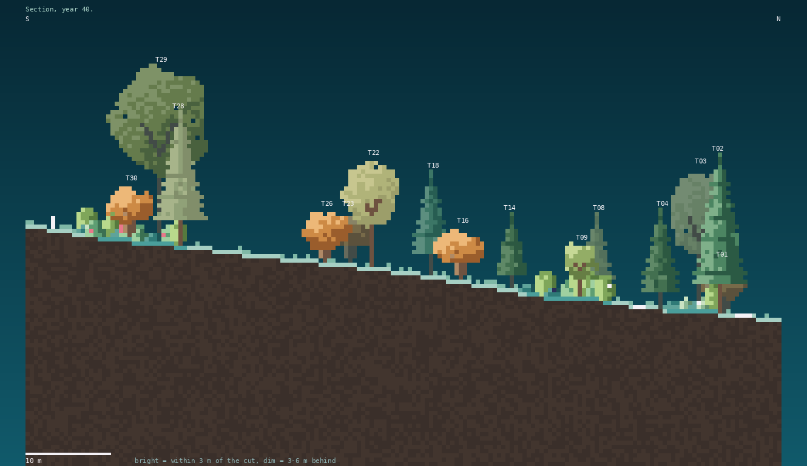
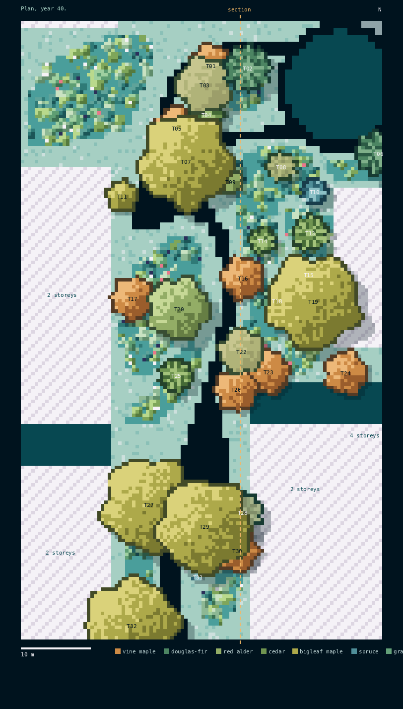
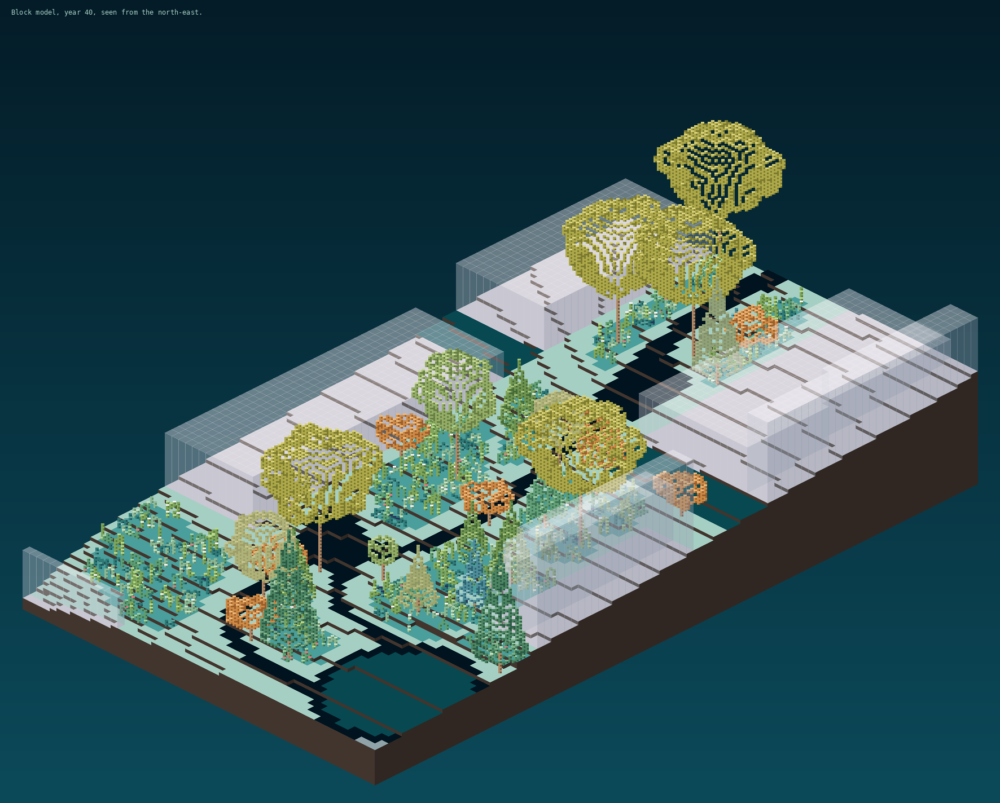

# The Story Editor, second prototype: Nootka Street

*Nootka Street Ecological Corridor Design Simulation · November 2026*

The graduate project asked how a drawing could hold a landscape's uncertainty. This prototype puts the same idea to work on a real planting design: the forest section of a concept design for Nootka Street, Vancouver (about 52 by 89 m, 32 tree plots, 11 shrub patches).

An engine grows the design through many possible 50-year futures. The designer reads the spread of outcomes, then assembles the next run from what they now know.

| Plan | Block model |
|---|---|
|  |  |

## What it does

1. **Run 0.** Every event is on and the engine makes every open choice: 60 designs, each met with the same 20 futures, 1,200 timelines.
2. **Read.** All timelines appear as a cloud in four classes, by which birds (Steller's jay, Anna's hummingbird) keep their habitat conditions. Inside a class, timelines are grouped by canopy and by how many first-planted trees are still alive.
3. **Open one timeline.** Plan, section and block model for years 1 to 50, drawn when opened. Click a tree or a shrub patch in any drawing to see its record.
4. **Critical issues.** Each report ends with the issues that matter most: what the issue is, whether it belongs to this one future or shows up across the run, and which module could change it.
5. **Assemble the next run** from three kinds of module:
   - **Event modules** are switches: dry summers, heat waves, wind storms, heavy snow, invasive plants, trampling, budget cuts.
   - **Management modules** are decisions people make: watering, replanting, clearing invasive plants, glade management, red alder.
   - **Plant modules** are anchors: fix the species at a plot, the shrub recipe, or winter mahonia.

Every run keeps a record of what was assembled and how it differs from run 0.

## Run it

The engine is Python and runs in the browser (Pyodide). Nothing is prepared in advance: Run is a real run.

- **On your computer:** download this folder, open `app/`, and double-click `run_local.bat` (Windows, needs Python 3). On other systems run `python3 -m http.server 8000` inside `app/` and open `http://localhost:8000/index.html`. Opening `index.html` directly does not work, because browsers do not start background threads from a file.
- **From the command line:** inside `engine/`, `python3 tests_check.py` runs the self-checks (needs numpy, scipy, shapely).

## What is here

| Folder | Contents |
|---|---|
| `app/` | The page: `index.html`, `worker.js`, `bundle.json` (engine, site and font), and `py/` (the Python runtime) |
| `engine/engine/` | `site.py` (grid from the Rhino export), `species.py` (traits and parameter ranges), `model.py` (one 50-year run), `explore.py` (sampling and anchoring), `story.py` (one timeline's report) |
| `engine/` | Drawing code (`render_*.py`), browser entry points (`web_api.py`), self-checks (`tests_check.py`), build scripts |
| `engine/inputs/` | The site as exported from the Rhino model, and the built grid |
| `docs/` | [Stage report](docs/stage-report.md) and [engine spec](docs/engine-spec.md) |

## How to read the results

- One timeline is one possible future of one design. It shows what can happen, not what will.
- The bird results test habitat conditions. They do not count birds.
- No yearly mortality rate is put in. A tree dies only when a modelled cause kills it (unwatered dry summer, heat wave, second dry summer in a row, wind storm, shade, end of lifespan), and the yearly rate is read off the result. Pests, disease, vandalism and planting failure are not modelled.
- Values set by judgement are marked J in the [engine spec](docs/engine-spec.md) and still need review.

## Credits

Design, questions, domain rules and review: Qianqian Viola Zhao. Built through AI-assisted development with Claude (Anthropic).

The `app/py/` folder holds a converted copy of [Pyodide](https://pyodide.org) 0.26.4 (MPL-2.0) with NumPy (BSD-3-Clause) and Pillow (HPND). Labels use DejaVu Sans Mono.
